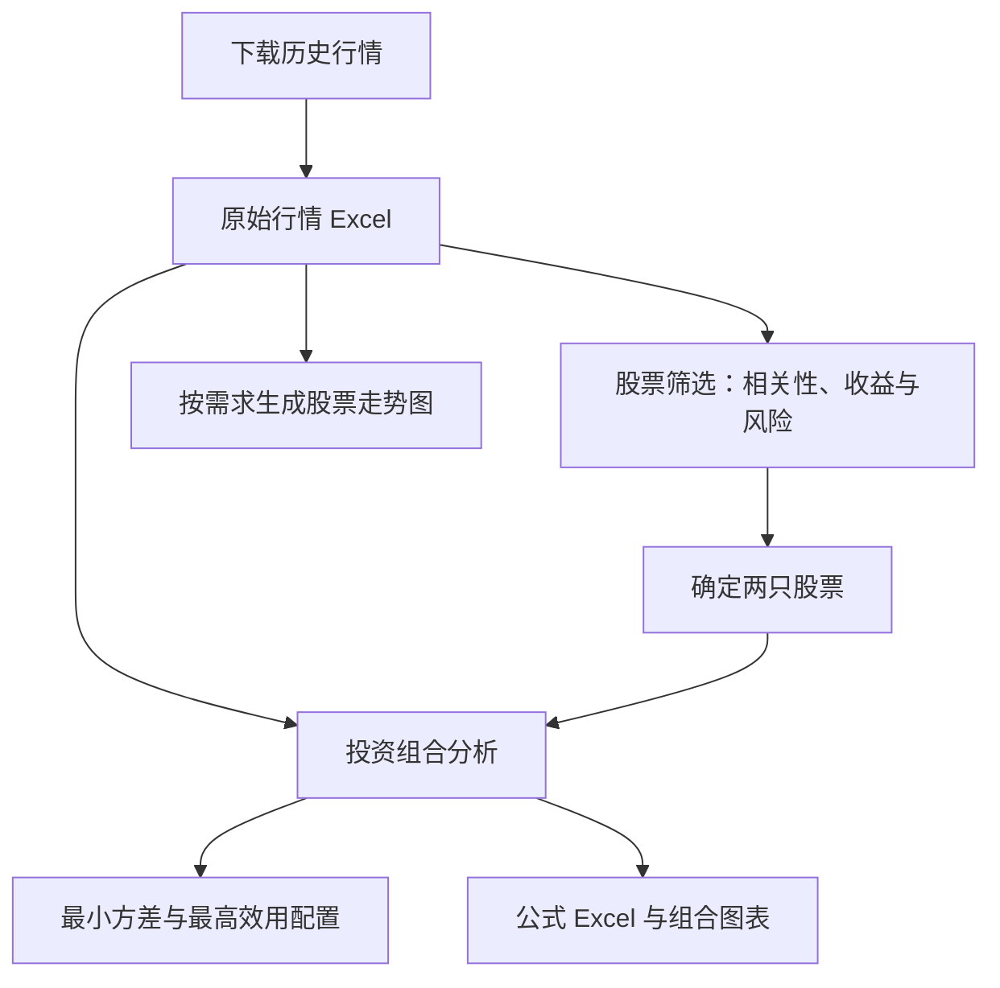

# A 股股票筛选与投资组合分析工具

一套基于 Python 的桌面分析工具，用于金融学课程作业与本地研究，涵盖历史行情下载、相关性筛选、投资组合权重计算及股票走势图生成。

各程序通过 Excel 文件衔接，启动后即可在图形界面中操作。

## 分析流程

1. 使用 `a_share_downloader_V2.py` 下载股票历史行情。
2. 将下载结果导入 `股票筛选分析器.py`，分析相关系数（correlation）、收益与风险，选择股票搭配。
3. 将同一份原始行情导入 `投资组合分析器.py`，选择两只股票并计算配置比例。
4. 根据展示需求，将原始行情导入 `本地股票走势查看器.py`，生成走势图。

> 筛选结果用于决定选择哪两只股票。投资组合分析器和走势查看器直接读取下载器生成的原始行情 Excel，不需要将相关系数表作为行情导入。



## 文件说明

| 文件 | 功能 |
| --- | --- |
| `a_share_downloader_V2.py` | 下载历史行情，导出 Excel 或 CSV |
| `股票筛选分析器.py` | 比较股票收益、风险、相关系数及协方差 |
| `投资组合分析器.py` | 计算两股投资组合的最小方差与最高效用配置 |
| `本地股票走势查看器.py` | 展示单股或多股走势，导出图片及图表数据 |

## 安装与运行

需要 **Python 3.11 或更高版本**，并支持 Tkinter 图形界面。

进入上述文件所在目录，安装依赖：

```bash
python -m pip install akshare pandas numpy openpyxl matplotlib xlsxwriter baostock requests
```

检查 Tkinter：

```bash
python -m tkinter
```

如果弹出测试窗口，说明图形界面组件可用。

macOS 或 Linux 用户如果使用 `python3` 命令，请将上述及下文的 `python` 替换为 `python3`。安装依赖与运行程序应使用同一个 Python 环境。

中文图表需要中文字体，例如微软雅黑、苹方或 Noto Sans CJK SC。

## 第一步：下载历史行情

```bash
python a_share_downloader_V2.py
```

1. 输入需要研究的股票代码。
2. 设置日期区间、行情周期和复权方式。
3. 点击 **获取并预览**，检查下载结果。
4. 选择导出目录，点击 **导出数据**。

股票代码支持逗号、空格、分号或换行分隔，例如：

```text
601398, 601288, 600036, 002371, 002049
```

下载指数时需添加前缀，例如：

```text
指数:000300
```

### 后续分析使用的数据设置

- **行情周期：日线**
- **导出格式：Excel**
- **复权方式：各股票保持一致**
- **课程示例区间：2014-01-01 至 2023-12-31**

下载器默认复权方式为“不复权”，结束日期为当天，请按研究方案主动调整。本项目课程示例使用后复权数据。

Excel 中包含行情和“下载说明”。请保留原始工作表名称、日期列与来源信息，后续工具会据此识别股票。

> 当前投资组合程序将投资决策时点固定为 `2024-01-01`，研究结束日期必须早于该日。

## 第二步：分析相关性，选择股票搭配

```bash
python 股票筛选分析器.py
```

1. 点击 **选择数据文件**，导入第一步下载的行情 Excel。
2. 检查研究区间、行业分类和复权口径。
3. 如有可靠的本地交易日历，可导入辅助检查。
4. 依次点击 **检查数据**、**开始分析**、**查看筛选结果**。
5. 根据相关系数、协方差、收益和风险，确定待研究的两只股票。
6. 点击 **导出Excel及热力图**，保存筛选依据。

主要输出包括：

- 个股收益与风险统计；
- 跨行业相关系数矩阵；
- 跨行业协方差矩阵；
- 日收益率宽表；
- 相关系数及协方差热力图。

配对统计基于两只股票的共同有效日期。默认比较银行业与半导体行业，可在界面调整。

**相关性较低不等于收益最高或组合风险最低。** 本步骤用于缩小研究范围，最终选股仍需结合研究目标和公司基本面判断。

## 第三步：计算投资组合配置比例

```bash
python 投资组合分析器.py
```

1. 导入第一步下载的原始行情 Excel。
2. 选择第二步确定的两只股票。
3. 设置研究日期、收益率频率和风险厌恶指数 `A`。
4. 选择权重组数，点击 **自动检查并开始计算**。
5. 查看最小方差组合、最高效用组合和相关图表。
6. 导出 Excel 或 PNG/SVG 图片。

> 程序默认收益率频率为“年”。如果需要日频分析，请切换为“日”。

### 权重组数

| 组数 | 股票 1 权重步长 |
| --- | --- |
| 101 组 | 1% |
| 1001 组 | 0.1% |
| 10001 组 | 0.01% |

各组数均包含 0% 和 100%，股票 2 权重为 `1 − 股票1权重`。也支持输入能完整等分 100% 的自定义步长。

权重限制在 0%—100%，不包含卖空和杠杆。网格越细，计算与 Excel 重算耗时可能越长。

### 计算方法

```text
组合预期收益 = w₁ × μ₁ + w₂ × μ₂

组合方差 = w₁² × s₁² + w₂² × s₂²
         + 2 × w₁ × w₂ × Cov₁₂

组合标准差 = √组合方差

组合效用 U = 组合预期收益 − 0.5 × A × 组合方差
```

- **最小方差组合**：当前权重网格中风险最低的配置。
- **最高效用组合**：当前 `A` 和收益率频率下，效用最高的配置。

两者可能不同。历史均值、方差和协方差均基于共同样本计算，样本方差与样本协方差使用 `n − 1` 分母。

### Excel 公式展示

正常分析结果默认生成 **9 张可见表和 5 张隐藏支撑表**。

| 工作表 | 内容 |
| --- | --- |
| 分析总览 | 研究设置与主要结果 |
| 最低方差及最高效用 | 最优配置摘要 |
| 年化统计 | 年化收益与风险 |
| 个股风险及协方差 |
