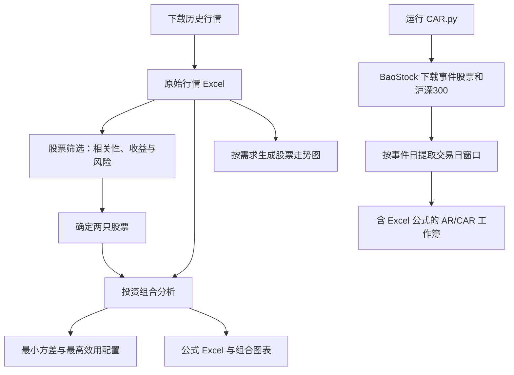

# A 股股票筛选与投资组合分析工具

一套基于 Python 的分析工具，用于金融学课程作业与本地研究，涵盖历史行情下载、相关性筛选、投资组合权重计算、股票走势图生成，以及半强式有效性事件研究（AR/CAR）。

股票筛选与投资组合分析模块通过 Excel 文件衔接；新增的 `CAR.py` 独立使用 BaoStock 获取行情，并导出带有可检查 Excel 公式的事件研究工作簿。

## 分析流程

**股票筛选与投资组合配置**

1. 使用 `a_share_downloader_V2.py` 下载股票历史行情。
2. 将下载结果导入 `股票筛选分析器.py`，分析相关系数（correlation）、收益与风险，选择股票搭配。
3. 将同一份原始行情导入 `投资组合分析器.py`，选择两只股票并计算配置比例。
4. 根据展示需求，将原始行情导入 `本地股票走势查看器.py`，生成走势图。

**半强式有效性事件研究（独立流程）**

5. 运行 `CAR.py`，通过 BaoStock 下载两只事件股票与沪深300指数行情，计算异常收益率（AR）和累计异常收益率（CAR），并导出包含原生 Excel 公式的结果工作簿。

> 筛选结果用于决定选择哪两只股票。投资组合分析器和走势查看器直接读取下载器生成的原始行情 Excel，不需要将相关系数表作为行情导入。事件研究模块不依赖上述原始行情 Excel，也不需要预先运行下载器。



## 文件说明

| 文件 | 功能 |
| --- | --- |
| `a_share_downloader_V2.py` | 下载历史行情，导出 Excel 或 CSV |
| `股票筛选分析器.py` | 比较股票收益、风险、相关系数及协方差 |
| `投资组合分析器.py` | 计算两股投资组合的最小方差与最高效用配置 |
| `本地股票走势查看器.py` | 展示单股或多股走势，导出图片及图表数据 |
| `CAR.py` | 独立下载事件研究行情，计算 AR/CAR，导出保留 Excel 公式的工作簿 |
| `Result Sample.zip` | 部分分析输出的结果示例 |

## 安装与运行

需要 **Python 3.11 或更高版本**，并支持 Tkinter 图形界面。

进入上述文件所在目录，安装依赖：

```bash
python -m pip install akshare pandas numpy openpyxl matplotlib xlsxwriter baostock requests
```

检查 Tkinter：

```bash
python -m tkinter
```

如果弹出测试窗口，说明图形界面组件可用。

macOS 或 Linux 用户如果使用 `python3` 命令，请将上述及下文的 `python` 替换为 `python3`。安装依赖与运行程序应使用同一个 Python 环境。

中文图表需要中文字体，例如微软雅黑、苹方或 Noto Sans CJK SC。

## 第一步：下载历史行情

```bash
python a_share_downloader_V2.py
```

1. 输入需要研究的股票代码。
2. 设置日期区间、行情周期和复权方式。
3. 点击 **获取并预览**，检查下载结果。
4. 选择导出目录，点击 **导出数据**。

股票代码支持逗号、空格、分号或换行分隔，例如：

```text
601398, 601288, 600036, 002371, 002049
```

下载指数时需添加前缀，例如：

```text
指数:000300
```

### 后续分析使用的数据设置

- **行情周期：日线**
- **导出格式：Excel**
- **复权方式：各股票保持一致**
- **课程示例区间：2014-01-01 至 2023-12-31**

下载器默认复权方式为“不复权”，结束日期为当天，请按研究方案主动调整。本项目课程示例使用后复权数据。

Excel 中包含行情和“下载说明”。请保留原始工作表名称、日期列与来源信息，后续工具会据此识别股票。

> 当前投资组合程序将投资决策时点固定为 `2024-01-01`，研究结束日期必须早于该日。

## 第二步：分析相关性，选择股票搭配

```bash
python 股票筛选分析器.py
```

1. 点击 **选择数据文件**，导入第一步下载的行情 Excel。
2. 检查研究区间、行业分类和复权口径。
3. 如有可靠的本地交易日历，可导入辅助检查。
4. 依次点击 **检查数据**、**开始分析**、**查看筛选结果**。
5. 根据相关系数、协方差、收益和风险，确定待研究的两只股票。
6. 点击 **导出Excel及热力图**，保存筛选依据。

主要输出包括：

- 个股收益与风险统计；
- 跨行业相关系数矩阵；
- 跨行业协方差矩阵；
- 日收益率宽表；
- 相关系数及协方差热力图。

配对统计基于两只股票的共同有效日期。默认比较银行业与半导体行业，可在界面调整。

**相关性较低不等于收益最高或组合风险最低。** 本步骤用于缩小研究范围，最终选股仍需结合研究目标和公司基本面判断。

## 第三步：计算投资组合配置比例

```bash
python 投资组合分析器.py
```

1. 导入第一步下载的原始行情 Excel。
2. 选择第二步确定的两只股票。
3. 设置研究日期、收益率频率和风险厌恶指数 `A`。
4. 选择权重组数，点击 **自动检查并开始计算**。
5. 查看最小方差组合、最高效用组合和相关图表。
6. 导出 Excel 或 PNG/SVG 图片。

> 程序默认收益率频率为“年”。如果需要日频分析，请切换为“日”。

### 权重组数

| 组数 | 股票 1 权重步长 |
| --- | --- |
| 101 组 | 1% |
| 1001 组 | 0.1% |
| 10001 组 | 0.01% |

各组数均包含 0% 和 100%，股票 2 权重为 `1 − 股票1权重`。也支持输入能完整等分 100% 的自定义步长。

权重限制在 0%—100%，不包含卖空和杠杆。网格越细，计算与 Excel 重算耗时可能越长。

### 计算方法

```text
组合预期收益 = w₁ × μ₁ + w₂ × μ₂

组合方差 = w₁² × s₁² + w₂² × s₂²
         + 2 × w₁ × w₂ × Cov₁₂

组合标准差 = √组合方差

组合效用 U = 组合预期收益 − 0.5 × A × 组合方差
```

- **最小方差组合**：当前权重网格中风险最低的配置。
- **最高效用组合**：当前 `A` 和收益率频率下，效用最高的配置。

两者可能不同。历史均值、方差和协方差均基于共同样本计算，样本方差与样本协方差使用 `n − 1` 分母。

### Excel 公式展示

正常分析结果默认生成 **9 张可见表和 5 张隐藏支撑表**。

| 工作表 | 内容 |
| --- | --- |
| 分析总览 | 研究设置与主要结果 |
| 最低方差及最高效用 | 最优配置摘要 |
| 年化统计 | 年化收益与风险 |
| 个股风险及协方差 | 个股均值、方差、标准差、协方差及相关性统计 |
| 全部权重结果 | 权重网格中各组合的收益、风险与效用 |
| 公式代入过程 | 主要组合公式及参数代入 |
| 多个A的比较 | 不同风险厌恶系数下的配置比较 |

实际工作表还包含样本诊断、交易日及数据质量检查等内容；部分计算支撑表会隐藏，具体以导出的工作簿为准。

## 独立模块：半强式有效性事件研究（`CAR.py`）

这一模块用于研究**公开公告前后的股票价格反应**，不依赖前面下载器生成的行情 Excel。程序通过 BaoStock 获取价格，按交易日计算股票与沪深300的收益率差，并将结果写入可复核的 Excel 工作簿。

### 运行方式

```bash
python CAR.py
```

程序启动时会先弹出系统保存窗口，可自行选择导出文件夹和文件名（默认：`半强式有效性_含Excel公式.xlsx`）。点击“保存”后才开始下载数据与生成工作簿；取消则退出。

需要 `baostock`、`pandas`、`openpyxl` 和可用的 Tkinter 桌面环境。上文的统一安装命令已包含所需第三方 Python 包。

### 当前内置研究设置

| 项目 | `CAR.py` 当前设置 |
| --- | --- |
| 美诺华 | `sh.603538`，后复权收盘价 |
| 三人行 | `sh.605168`，后复权收盘价 |
| 市场基准 | `sh.000300`（沪深300），指数原始收盘点位 |
| 美诺华事件日（T=0） | `2021-04-23` |
| 三人行事件日（T=0） | `2023-03-28` |
| 行情下载日期 | `2021-04-01` 至 `2023-05-15` |
| 分析窗口 | T=−5 至 T=+10，共16个交易日 |
| 基期 | 额外保留 T=−6，用于计算 T=−5 的日收益率 |

这些股票代码、事件日和数据区间目前在 `CAR.py` 源码中固定；要研究其他事件，需修改脚本中的 `stocks`、`events` 和日期参数。

> **事件日口径**：这里的 T=0 是公告发布后可交易的首个交易日。当前事件日已按两个案例预设，程序本身不会自动检索公告或判断信息是否于收盘后发布。

### AR 与 CAR 计算方法

个股和市场的简单日收益率分别为：

```text
个股收益率 rᵢ,t = Pᵢ,t / Pᵢ,t−1 − 1
市场收益率 rₘ,t = Pₘ,t / Pₘ,t−1 − 1

异常收益率 ARₜ = rᵢ,t − rₘ,t
累计异常收益率 CARₖ = Σ ARₜ（t = −5, …, k）
```

这里使用的是**市场调整收益率法**，即直接以沪深300日收益率作为市场基准，不涉及回归估计的 α、β。先按日期对齐股票与指数的有效价格，再按交易日顺序计算。为保证 T=−5 的收益率可计算，工作表还包含只用于计算的 T=−6 行。

在“结果汇总”中，**公告后 CAR 变化（百分点）**计算为：

```text
[CAR(T=+10) − CAR(T=0)] × 100
```

它与“从 T=−5 累计至 T=+10 的 CAR”不是同一个指标，写报告时应明确区分。

### Excel 输出与复核

运行成功后，生成一个 `.xlsx` 文件，包含4张工作表：

| 工作表 | 内容 |
| --- | --- |
| `结果汇总` | 两个案例的 T=0 AR、T=0 CAR、T=+10 CAR，以及公告后 CAR 变化 |
| `原始价格` | BaoStock 下载的三组日收盘价（个股后复权、指数不复权） |
| `美诺华事件研究` | 美诺华 T=−6 至 T=+10 的逐日价格、收益率、AR、CAR |
| `三人行事件研究` | 三人行 T=−6 至 T=+10 的逐日价格、收益率、AR、CAR |

事件研究表中的价格列引用“原始价格”，收益率、AR 和 CAR 列均使用 **Excel 原生公式**，例如：

```excel
=C8/C7-1
=D8/D7-1
=E8-F8
=SUM($G$3:G8)
```

上述示例依次对应个股收益率、市场收益率、AR 和 CAR（具体行号随所在行变化）。修改原始价格后，可由 Excel 重新计算相关结果。

`openpyxl` 负责写入公式，本身不计算公式结果。首次导出后建议用 **Microsoft Excel 打开、等待重算并保存**，再查看或分享汇总数值。

### 数据来源与注意事项

- 该模块使用 **BaoStock**，与前面的 `a_share_downloader_V2.py` 所使用的行情来源是两条独立数据流程。
- 两只事件股票采用同一后复权口径；沪深300采用原始指数点位。不同数据服务的复权价格尺度可能不同，应重点核对**交易日期和收益率**，不要只比较收盘价绝对值。
- 当前方法描述的是公告前后异常收益及价格调整过程。AR 较大或 CAR 后续波动，并不能单独作为市场整体半强式有效或无效的证明。

项目各程序的源码和示例输出均在本仓库中。
